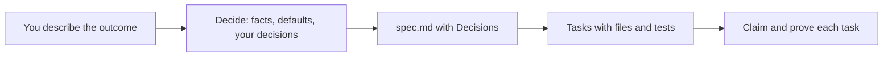

# The Decide step

Every new increment starts with a short Decide step, before `spec.md` is written. The agent settles what it can find out on its own and asks you only the decisions that are yours to make. You answer a few questions instead of correcting a wrong spec later.

The step arrived in SpecWeave 3.0.21 (16 October 2026) and is on by default.

## How it runs

1. **Think first.** The agent reads the code and the config and settles every fact itself.
2. **Triage.** Each open decision is one of three kinds:

   | Kind | What the agent does |
   |---|---|
   | A fact | Looks it up. Never asks. |
   | Its call | Reversible or low impact: picks a default and lists it. |
   | Yours | Hard to reverse, costly, or a matter of taste: asks you. |

3. **Ask.** Only your decisions, at most five, the highest impact first. Each comes with one clause on why it matters and two to four options, the recommended one first. "Yes" accepts the recommendation. Tools with a structured question tool show the questions as a card.
4. **Record.** The result goes under `## Decisions` in `spec.md`:

   ```markdown
   ## Decisions
   ### Asked
   - D-01 Store rate limits in Redis or in memory? → in memory, Redis later (user).
   ### Defaulted (change any before sw-do)
   - D-02 Limit per API key, not per IP (NAT users share IPs).
   ### Open
   - none
   ```

   Every default is listed, so you can reject one you never saw asked. Each answer is applied to Scope, the acceptance criteria and Approach.

A clear request asks nothing. "Fix the typo in the README" goes straight to the spec.

## Choose the depth

`planning.deepInterview` in `.specweave/config.json`:

| Value | Behaviour |
|---|---|
| `"critical"` (default) | As above: at most five questions. |
| `"deep"` | Runs the full [grill-me](/docs/guides/grill-and-glossary) interview, in rounds, with no cap. Also installs that skill. |
| `"off"` | States the defaults and asks nothing. |

A 2.x project with `"warn"` reads as `"critical"`. The step never blocks: with `"off"`, or when you answer "your call", the agent proceeds on its stated defaults.

## Where it sits



Read the spec before any code is written. It is the cheapest moment to catch a misunderstanding. See [your first increment](/docs/getting-started/first-increment) and [the daily loop](/docs/workflows/overview).
